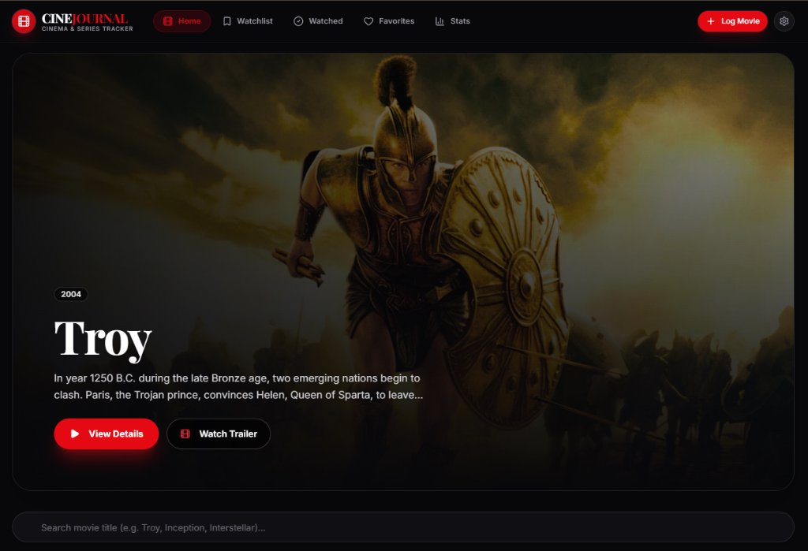

<div align="center">

# 🎬 CineJournal 2.0
### *Your Personal Netflix-Inspired Movie & Series Tracker*

[](https://react.dev/)
[](https://www.typescriptlang.org/)
[](https://tailwindcss.com/)
[](https://tanstack.com/)
[](https://supabase.com/)
[](https://www.themoviedb.org/)

<br />

<p align="center">
  
</p>

**CineJournal** is a sleek, ultra-modern cinema journal crafted for film lovers. Track your screenings, curate your watchlist, rate films, log personal reviews, watch official YouTube trailers directly in-app, and experience your personal **CineWrapped** annual movie journey.

[Features](#-key-features) • [Tech Stack](#-tech-stack) • [Quick Start](#-quick-start) • [Environment Setup](#-environment-variables) • [Deployment](#-deployment-vercel)

</div>

---

## 🌟 Key Features

### 🍿 Cinematic Netflix Obsidian & Crimson Aesthetic
- **Obsidian Dark Mode (`#08080a`)** with crafted Netflix Crimson accents (`rgb(229, 9, 20)`) and amber star ratings.
- **Widescreen Responsive Hero**: Majestic spotlight hero banner displaying movie backdrops, overview synopsis, and quick actions.
- **Glassmorphism & Micro-animations**: Frosted glass cards, smooth reveal animations, and ambient glow on hover.
- **Mobile-First Experience**: Floating bottom navigation dock, compact 2-column mobile cards, and touch-friendly quick action modals.

### 🎬 In-App Official Trailer Player
- Pop open an official **16:9 YouTube trailer** modal for any movie directly from the hero banner or movie details page.
- Smart trailer detection using TMDB API with prioritized official YouTube trailer streams and fallback search.
- Clean backdrop dismissal with automatic audio pause and unmount on close.

### ✨ CineWrapped — Spotify Wrapped-Style Annual Story
- **Interactive 5-Slide Story Experience**: Relive your cinema milestones like Spotify Wrapped or Instagram Stories.
- **Cinematic Persona Archetype**: Automatically determines your film personality based on your watch history (*The Cosmic Voyager 🚀*, *The Deep Soul 🍷*, *The Mastermind Sleuth 🕵️*, *The Adrenaline Seeker ⚡*).
- **Deep Insights**: Total screening hours, equivalent continuous days, top genres with percentage bars, and your #1 rated masterpiece.
- **One-Click Share Ticket**: Formatted shareable summary ticket with emojis ready to copy and share with friends on social media.
- **Annual Filter**: Toggle between specific years (e.g. 2026, 2025, 2024) or view your **All-Time** journey.

### ⚡ Two-Way Offline-Safe Cloud Synchronization
- **Zero-Data-Loss Architecture**: Local-first storage with automatic secondary backup fallback (`cinejournal.movies.v2` + backup).
- **Two-Way Merging**: Seamless merge between local screenings and Supabase cloud database upon sign-in/sign-up—session changes never wipe your watchlist.
- **Dual-Layer TMDB Fetch**: High-performance server functions paired with direct client-side fallback to ensure search never drops offline.

### 🔒 Modern Authentication & Password Recovery
- Built-in Supabase Auth with clean tabs for **Sign In**, **Create Account**, and **Password Reset**.
- Live password strength analyzer, show/hide eye toggle, and confirmation check.
- Functional **Forgot Password** email recovery dispatch.

### 📊 Cinema Analytics & Letterboxd-Style Views
- Complete `/stats` dashboard featuring total screen time, rating distributions, genre breakdowns, and release year timeline.
- Grid & List view toggle across **Watched**, **Watchlist**, and **Favorites** routes.

---

## 🛠 Tech Stack

| Layer | Technologies |
|---|---|
| **Frontend Framework** | [React 19](https://react.dev/) + [TypeScript](https://www.typescriptlang.org/) |
| **Routing & SSR** | [TanStack Router](https://tanstack.com/router) + [TanStack Start](https://tanstack.com/start) |
| **Styling & Theme** | [Tailwind CSS v4](https://tailwindcss.com/) + Custom Glassmorphism Utilities |
| **Icons & UI** | [Lucide React](https://lucide.dev/) + [Radix UI Primitives](https://www.radix-ui.com/) |
| **State & Data** | [TanStack Query v5](https://tanstack.com/query) + Custom Local-First Provider |
| **Backend & Auth** | [Supabase Database & Auth](https://supabase.com/) |
| **Movie Metadata** | [The Movie Database (TMDB API v3)](https://www.themoviedb.org/) |
| **Bundler & Server** | [Vite 8](https://vitejs.dev/) + [Nitro](https://nitro.unjs.io/) |

---

## 🚀 Quick Start

### Prerequisites
- Node.js 18+ or 20+
- Free [TMDB API Read Access Token](https://www.themoviedb.org/settings/api)
- (Optional) [Supabase Project](https://supabase.com/) for multi-device sync

### 1. Clone & Install

```bash
git clone https://github.com/your-username/cinema-journal-2.0.git
cd cinema-journal-2.0
npm install
```

### 2. Environment Configuration

Copy the example environment template:

```bash
cp .env.example .env
```

Configure your `.env` file:

```env
# TMDB API Read Access Token (v4 auth or v3 API)
TMDB_READ_TOKEN=your_tmdb_read_access_token_here
VITE_TMDB_READ_TOKEN=your_tmdb_read_access_token_here

# Supabase (Optional for Cloud Sync & Auth)
VITE_SUPABASE_URL=https://your-project-id.supabase.co
VITE_SUPABASE_ANON_KEY=your_supabase_anon_key_here
```

### 3. Run Development Server

```bash
npm run dev
```

Visit [http://localhost:3000](http://localhost:3000) to open the application in your browser.

---

## 🚢 Deployment (Vercel)

This project is optimized for deployment on **Vercel** with zero-config SSR:

1. Push your repository to **GitHub**.
2. Import the project into [Vercel](https://vercel.com/new).
3. Under **Settings → Environment Variables**, add:
   - `TMDB_READ_TOKEN`
   - `VITE_TMDB_READ_TOKEN`
   - `VITE_SUPABASE_URL`
   - `VITE_SUPABASE_ANON_KEY`
4. Click **Deploy**.

> [!TIP]
> The repository includes npm overrides in `package.json` ensuring all TanStack dependencies are securely pinned to patched versions (`^1.168.60`), preventing any upstream CVE blocks on Vercel.

---

## 📂 Project Structure

```text
cinema-journal-2.0/
├── public/                 # Static assets & screenshots
│   ├── preview.jpg         # Hero preview showcase
│   └── favicon.ico
├── src/
│   ├── components/         # Reusable UI components
│   │   ├── AppShell.tsx    # Responsive header & container
│   │   ├── BottomNav.tsx   # Mobile floating dock
│   │   ├── MovieCard.tsx   # Cinematic poster & row card
│   │   ├── TrailerModal.tsx# In-app YouTube trailer player
│   │   ├── CineWrappedModal.tsx # Spotify Wrapped story recap
│   │   └── TmdbSearchPicker.tsx # Quick search & logging modal
│   ├── lib/
│   │   ├── movies-store.tsx    # Two-way sync & local persistence
│   │   ├── supabase-auth.ts    # Authentication & password reset
│   │   ├── supabase-movies.ts  # Cloud upserts & batch sync
│   │   ├── tmdb.ts             # Client fetch & trailer selector
│   │   └── tmdb.functions.ts   # Server functions for TMDB
│   ├── routes/             # TanStack file-based routes
│   │   ├── index.tsx       # Home hero, recent & watchlist shelves
│   │   ├── movie.$id.tsx   # Cinema movie details & trailer
│   │   ├── stats.tsx       # Detailed analytics dashboard
│   │   ├── wrapped.tsx     # Dedicated CineWrapped route
│   │   ├── watched.tsx     # Watched grid/list collection
│   │   ├── watchlist.tsx   # Up-next watchlist shelf
│   │   ├── favorites.tsx   # Starred favorites shelf
│   │   └── settings.tsx    # Auth, sync & account manager
│   └── styles.css          # Netflix dark theme & glass utilities
├── package.json
└── vite.config.ts
```

---

## 🤝 Contributing

Contributions, feature requests, and bug reports are warmly welcome!
1. Fork the repo.
2. Create your feature branch (`git checkout -b feature/amazing-feature`).
3. Commit your changes (`git commit -m 'feat: add amazing feature'`).
4. Push to the branch (`git push origin feature/amazing-feature`).
5. Open a Pull Request.

---

## 📜 License

This project is open-source and available under the [MIT License](LICENSE).

<div align="center">
  <sub>Crafted with ❤️ for cinema enthusiasts worldwide.</sub>
</div>
